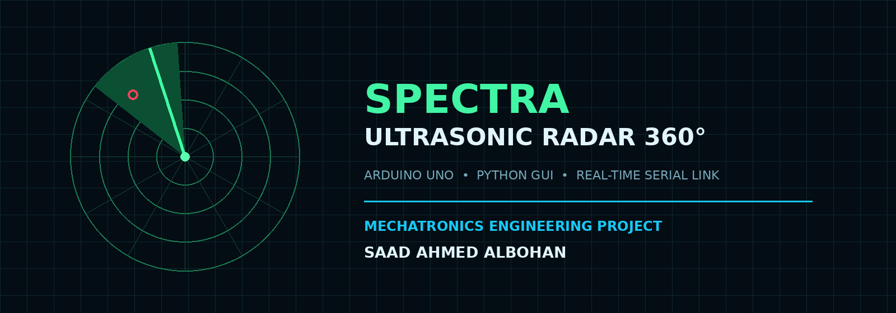
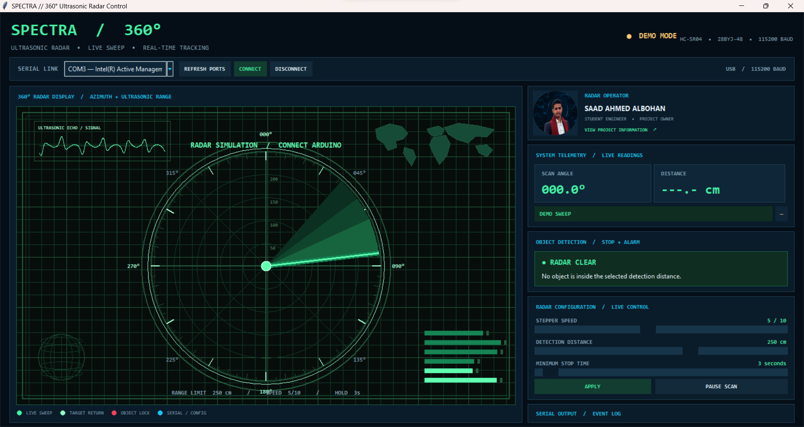
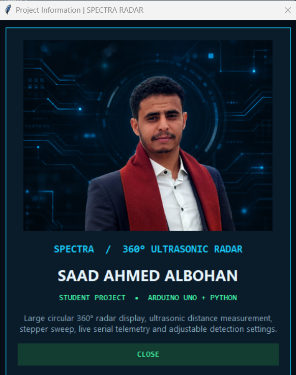
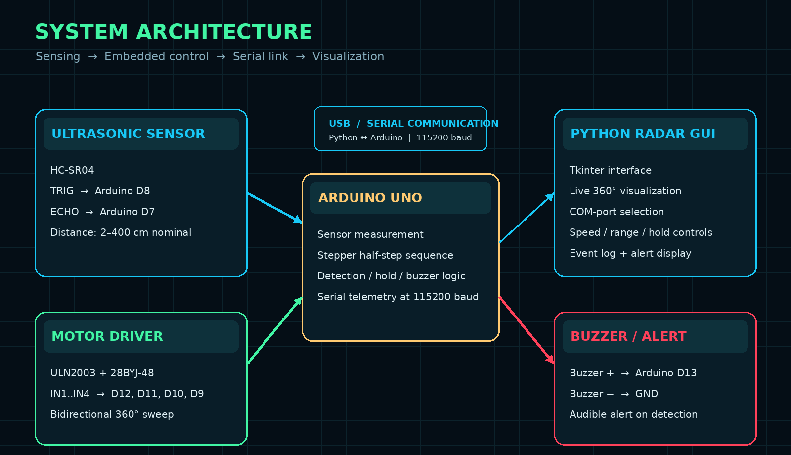

# SPECTRA RADAR 360°

<p align="center">
  
</p>

<p align="center">
  <strong>Ultrasonic Scanning • Embedded Control • Live Python Visualization</strong><br>
  <em>Arduino Uno · 28BYJ-48 · ULN2003 · HC-SR04 · Python / Tkinter</em>
</p>

<p align="center">
  
  
  
  
  
</p>

---

## 📡 Project Overview

**SPECTRA RADAR 360°** is a mechatronics and embedded-systems prototype that combines a rotating ultrasonic sensor, a stepper-motor drive, an Arduino controller, and a desktop radar interface written in Python.

A 28BYJ-48 stepper motor rotates the HC-SR04 ultrasonic sensor through a full-revolution scan. The Arduino estimates the scan angle from the commanded motor steps, measures distance, and sends telemetry to the Python application over USB Serial. When a valid echo falls inside the configured detection threshold, the controller holds the motor at the current scan position, activates the buzzer, and reports the angle and distance. The Python interface changes to an alert state and displays the incoming measurements.

> **Important:** This is an educational proximity-scanning prototype, not a certified surveillance, navigation, or safety system. The HC-SR04 has a nominal range of about 2–400 cm; actual performance depends on target size, material, orientation, mounting, and the environment.

## 🖥️ Interface Preview

| Normal scan | Object detected |
|---|---|
|  |  |

The screenshots are interface previews. A live session follows Arduino telemetry; demo animation is shown before a serial connection is established.

## 🎯 Project Objectives

- Build a low-cost rotating ultrasonic scanning platform.
- Measure object distance using the HC-SR04 time-of-flight principle.
- Drive the 28BYJ-48 using a ULN2003 board and a half-step sequence.
- Estimate the scan angle from the stepper position counter.
- Stop and hold the scan when an object enters the configured distance zone.
- Exchange settings and telemetry using a documented newline-delimited Serial protocol.
- Visualize angle, distance, detection state, and events in a Python desktop GUI.

## 🧩 System at a Glance

<p align="center">
  
</p>

| Subsystem | Main responsibility |
|---|---|
| Hardware | Distance sensing, mechanical rotation, audible alert |
| Arduino firmware | Step sequence, distance sampling, detection logic, telemetry |
| Serial link | Sends configuration commands to Arduino and telemetry to Python |
| Python application | Radar visualization, controls, connection management, event log |

## 🔌 Hardware Components

| Component | Purpose | Connection summary |
|---|---|---|
| Arduino Uno | Main controller | USB Serial to PC |
| 28BYJ-48 stepper motor | Rotates the sensor platform | Motor socket on ULN2003 |
| ULN2003 driver board | Switches the stepper coils | IN1–IN4 to D12, D11, D10, D9 |
| HC-SR04 | Measures distance | TRIG D8, ECHO D7 |
| Buzzer | Local audible alert | Positive D13, negative GND |
| Suitable motor supply | Powers the motor/driver | Voltage must match the motor version; common GND |

See [Hardware Guide](hardware/README.md) and [Pin Connections](hardware/wiring/pin-connections.md).

## 🧠 Firmware and Software

### Arduino firmware

The firmware is in [`firmware/arduino/SPECTRA_Radar_Arduino.ino`](firmware/arduino/SPECTRA_Radar_Arduino.ino). It uses a custom eight-state half-step sequence, measures distance at approximately 65 ms intervals, maintains the requested scan position during an alert, and emits `RADAR`, `EVENT`, `CONFIG`, `READY`, and `ERROR` messages.

### Python application

The desktop GUI is in [`software/python/radar_gui.py`](software/python/radar_gui.py). It uses Tkinter for the interface, PySerial for COM-port communication, and Pillow for image assets. It includes a 360° radar display, operator information card, live telemetry, detection panel, adjustable speed / threshold / hold-time settings, and a Serial event log.

## ⚙️ Default Operating Values

| Parameter | Default | Supported command range |
|---|---:|---:|
| Serial baud rate | 115200 | Fixed in both programs |
| Stepper speed level | 5 / 10 | 1–10 |
| Detection threshold | 250 cm | 2–400 cm |
| Minimum stop time | 3 s | 2–30 s |
| Distance measurement interval | 65 ms | Firmware constant |
| Clear readings required | 4 | Firmware constant |
| Nominal half-steps per output revolution | 4096 | Calibrate for the actual motor |

The **minimum stop time** is not a forced restart timer. If an object remains inside the detection zone after the timer expires, the stepper remains stopped and the buzzer remains active. Scanning resumes only after the minimum hold time has elapsed and four consecutive readings are outside the detection zone.

## 🚀 Quick Start

1. Assemble the circuit using the [wiring diagram](hardware/wiring/wiring-diagram.png).
2. Verify the motor's rated voltage and provide a suitable supply to the ULN2003 / motor.
3. Open the `.ino` file in Arduino IDE, select **Arduino Uno**, select the correct port, and upload.
4. Close Arduino IDE Serial Monitor so that Python can open the same COM port.
5. Install Python dependencies from the repository root:

   ```bash
   python -m pip install -r requirements.txt
   ```

6. Launch the interface:

   ```bash
   python software/python/radar_gui.py
   ```

7. Select the Arduino serial port, connect, then adjust speed, detection distance, and minimum stop time.

Full instructions: [Installation Guide](docs/installation-guide.md) and [User Manual](docs/user-manual.md).

## 🔗 Serial Communication

The link uses **115200 baud**, 8 data bits, no parity, and one stop bit (8-N-1, the usual Arduino/PySerial default). Each command and response is an ASCII line terminated by `\n`.

**Python → Arduino commands**

| Command | Meaning |
|---|---|
| `SPEED,n` | Set stepper speed level, 1–10 |
| `LIMIT,n` | Set detection threshold in cm, 2–400 |
| `HOLD,n` | Set minimum stop duration in seconds, 2–30 |
| `PAUSE` | Pause scanning manually |
| `RESUME` | Resume scanning manually |
| `PING` | Request a ready response |

**Arduino → Python telemetry**

`RADAR,angle,distance,detected,direction,paused,speed,holdRemainingMs,limit,holdSeconds`

The full field definitions and event formats are documented in [Communication Protocol](docs/communication-protocol.md).

## 📁 Repository Map

| Folder / file | Contents |
|---|---|
| [`firmware/arduino/`](firmware/arduino/) | Arduino source and firmware notes |
| [`software/python/`](software/python/) | Python GUI and launch instructions |
| [`hardware/`](hardware/) | Wiring reference and prototype photo |
| [`assets/`](assets/) | Interface screenshots, logo, profile image, icons |
| [`docs/`](docs/) | System design, setup, protocol, manual, report |
| [`tests/`](tests/) | Serial examples and test checklist/results |
| `requirements.txt` | Python package dependencies |
| `LICENSE` | MIT License |

## 🧪 Testing and Limitations

The test folder contains the expected Serial message format and a practical bench-test checklist. Physical performance must be validated on the assembled hardware. The displayed angle is calculated from commanded step counts; the project does **not** use an encoder to measure the true mechanical shaft angle. The nominal 4096 half-step value may require calibration for an individual motor / gearbox.

The ultrasonic sensor reports distance, not object identity. It may miss angled, soft, narrow, or acoustically absorbent targets, and it can receive reflections from nearby surfaces. Do not use this prototype as a substitute for certified safety or security equipment.

## 👨‍💻 Project Author

**SAAD AHMED ALBOHAN**  
Mechatronics Engineering · Faculty of Engineering · Dhamar University

<p align="center">
  
</p>

---

<p align="center"><strong>SPECTRA RADAR 360°</strong><br>From embedded control to real-time visualization.</p>
