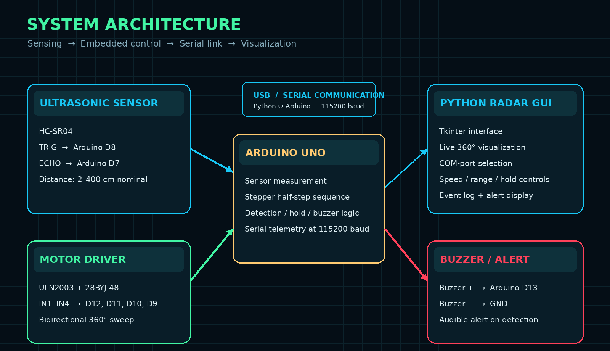

# 🧠 System Architecture

## Architecture Diagram

  

## 1. Hardware Layer

- **HC-SR04:** provides echo time used to calculate distance.
- **28BYJ-48:** rotates the sensor mount.
- **ULN2003:** switches the motor winding phases according to the Arduino sequence.
- **Buzzer:** provides a local audible alert during detection.
- **Arduino Uno:** executes time-critical sensing and motion control.

## 2. Firmware Layer

The Arduino sketch contains these functional blocks:

| Block | Responsibility |
|---|---|
| Pin initialization | Configures motor, trigger, echo, and buzzer pins |
| Half-step sequencer | Energizes the four motor phases in an eight-state order |
| Distance measurement | Generates the TRIG pulse and reads ECHO duration |
| Detection logic | Compares valid distance with the configured limit |
| Hold / clear logic | Keeps the motor stopped until hold time and clear-reading rules are satisfied |
| Serial command parser | Receives settings and pause/resume commands |
| Telemetry transmitter | Sends angle, distance, detection state, direction, and settings |

## 3. Desktop Software Layer

The Python application uses Tkinter for the GUI, PySerial for the serial connection, and Pillow for profile images. A background reader thread reads complete Serial lines and passes them through a thread-safe queue. The Tkinter main thread parses the queue and updates the display, avoiding direct widget changes from the background thread.

## 4. Data Flow

**Sensor to GUI:**

`HC-SR04 → Arduino measurement → distance/angle state → RADAR telemetry → Python parser → radar display`

**GUI to controller:**

`Python controls → SPEED / LIMIT / HOLD / PAUSE / RESUME → Arduino command parser → controller settings/state`

## 5. Coordinate and Angle Model

The Arduino maintains `positionSteps` between zero and `STEPS_PER_REV`. The estimated angle is calculated as:

`angle = positionSteps × 360 / STEPS_PER_REV`

The current sketch uses `STEPS_PER_REV = 4096` as a nominal half-step revolution. The motor moves from the 0-step endpoint to the one-revolution endpoint and then reverses direction. This creates a bidirectional 360° sweep. The sensor does not report its own angle; angle is inferred from commanded motor steps.

## 6. Detection State Machine

- **SCANNING:** valid measurements are outside the selected limit; motor steps continue.
- **DETECTED:** a valid reading is inside the limit; motor stepping stops and the buzzer is enabled.
- **HOLD:** the minimum stop timer is running while measurements continue.
- **CLEAR CONFIRMATION:** four consecutive readings are outside the detection zone.
- **RESUME:** only after both the minimum hold interval and clear confirmation are satisfied.
- **MANUAL PAUSE:** a host pause command prevents movement independently of object detection.

If a target remains within range, the system remains in the detected state even after the timer expires.
