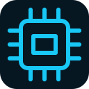

# ⚙️ Arduino Firmware

This folder contains the Arduino Uno firmware that coordinates the stepper motor, ultrasonic sensor, buzzer, and USB Serial connection.

## 📄 Source File

- [`SPECTRA_Radar_Arduino.ino`](SPECTRA_Radar_Arduino.ino) — complete Arduino sketch.

## 🔩 Responsibilities

1. Configure the ULN2003 input pins, HC-SR04 pins, and buzzer pin.
2. Generate the 28BYJ-48 eight-state half-step sequence.
3. Sweep the motor over a nominal 360° output-shaft revolution and reverse direction at the endpoints.
4. Trigger the HC-SR04 and convert echo time to distance in centimeters.
5. Compare valid measurements with the configured detection limit.
6. Hold the stepper at the current commanded position, activate the buzzer, and report an event while a target is detected.
7. Resume only after the minimum hold interval has elapsed and four consecutive readings are outside the detection zone.
8. Receive live configuration commands and manual pause/resume commands from Python.

## 🔌 Pin Assignment

| Arduino Uno pin | Connected device | Signal |
|---|---|---|
| D12 | ULN2003 | IN1 / N1 |
| D11 | ULN2003 | IN2 / N2 |
| D10 | ULN2003 | IN3 / N3 |
| D9 | ULN2003 | IN4 / N4 |
| D8 | HC-SR04 | TRIG |
| D7 | HC-SR04 | ECHO |
| D13 | Buzzer | Positive / signal |
| 5V | HC-SR04 | VCC |
| GND | HC-SR04 and buzzer | Ground |

The ULN2003 / motor supply must match the exact 28BYJ-48 version. When an external supply is used, connect its ground to Arduino GND.

## ⚙️ Firmware Parameters

| Constant / variable | Current value | Meaning |
|---|---:|---|
| `STEPS_PER_REV` | 4096 | Nominal half-steps per output revolution |
| `MEASURE_INTERVAL_MS` | 65 ms | Distance sampling interval |
| `ECHO_TIMEOUT_US` | 25000 µs | Echo wait timeout |
| `CLEAR_READINGS_TO_RESUME` | 4 | Consecutive clear readings required |
| Initial `speedLevel` | 5 | Startup speed level |
| Initial `stopDurationSeconds` | 3 s | Minimum hold time |
| Initial `detectionLimitCm` | 250 cm | Detection threshold |

## 🔗 Serial Settings

- Baud rate: `115200`
- Line ending: newline (`\n`)
- Commands: `SPEED,n`, `LIMIT,n`, `HOLD,n`, `PAUSE`, `RESUME`, `PING`
- Telemetry and event formats: see [`../../docs/communication-protocol.md`](../../docs/communication-protocol.md).

## ⬆️ Upload

1. Open `SPECTRA_Radar_Arduino.ino` in Arduino IDE.
2. Select **Tools → Board → Arduino AVR Boards → Arduino Uno**.
3. Select the Arduino COM port.
4. Click **Upload**.
5. Close Serial Monitor before connecting from the Python GUI.

## ⚠️ Calibration Notes

`STEPS_PER_REV = 4096` is a nominal starting value for a common 28BYJ-48 half-step configuration. Gearbox tolerances and motor variants can change the actual rotation. Calibrate the value against a marked mechanical revolution if angle accuracy matters. The angle is an open-loop step estimate, not encoder feedback.

