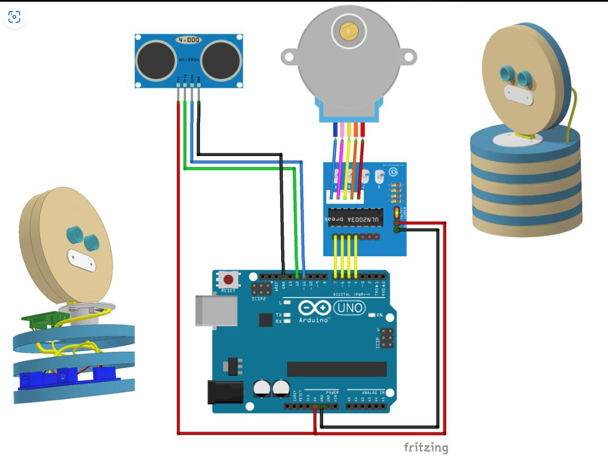
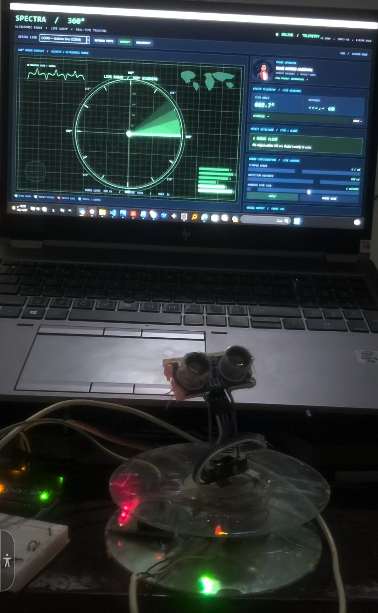

# 🔌 Hardware System

The hardware subsystem is an Arduino-controlled rotating ultrasonic scanner. The stepper motor positions the HC-SR04 sensor around the horizontal scan axis; the sensor measures the distance to the nearest suitable reflecting surface within its acoustic beam.

## 🧩 Bill of Materials

| Item | Quantity | Role |
|---|---:|---|
| Arduino Uno | 1 | Main controller and USB Serial interface |
| 28BYJ-48 stepper motor | 1 | Rotates sensor platform |
| ULN2003 driver board | 1 | Drives the stepper coils |
| HC-SR04 ultrasonic module | 1 | Distance measurement |
| Buzzer | 1 | Audible detection alert |
| Suitable DC supply | 1 | Motor / driver power, matched to motor rating |
| Jumper wires and mounting base | As needed | Electrical and mechanical assembly |
| USB cable | 1 | Programming and Serial communication |

## 🧭 Subsystems

- **Motion:** Arduino D12–D9 drive the ULN2003 input sequence.
- **Sensing:** D8 triggers the ultrasonic burst; D7 reads the Echo pulse.
- **Alert:** D13 controls the buzzer.
- **Host connection:** USB connects the Uno to the PC for programming and runtime Serial communication.

## 🖼️ Wiring Reference

  

Detailed mapping: [wiring/pin-connections.md](wiring/pin-connections.md).

## 📷 Prototype Photo

  

This is a project prototype photograph. The physical mounting, cable routing, and power arrangement may differ from the simplified wiring diagram.

## ⚡ Power and Grounding

- Verify whether the specific 28BYJ-48 motor is rated for 5 V or 12 V before powering it.
- Power the motor through the ULN2003 driver using a supply capable of the motor's current demand.
- Do not assume the Arduino 5 V pin can safely supply the stepper motor.
- Join external motor-supply GND and Arduino GND so the control signals share a reference.
- Keep the ultrasonic Echo signal within the Arduino Uno's 5 V logic range; the standard HC-SR04 module is a 5 V device.
- Avoid loose wires and exposed conductors around the rotating assembly.

## 📐 Mechanical Notes

The firmware uses a nominal 4096 half-step count per output-shaft revolution. Secure the sensor mount so the module does not wobble, ensure the rotating assembly clears its base and wires, and calibrate the angle count against a known mechanical revolution.

## ⚠️ Sensor Limitations

HC-SR04 is an ultrasonic ranging module, not a camera or object classifier. Its usable range and repeatability depend on target shape, angle, surface material, temperature, and surrounding reflections. Narrow or soft targets may be missed. Do not treat its detection output as a certified safety sensor.

