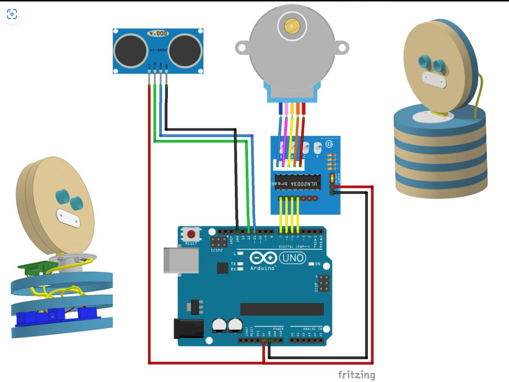

# 🧷 Wiring and Pin Map

This folder contains the electrical connection reference for the SPECTRA RADAR 360° prototype.

- [`pin-connections.md`](pin-connections.md) — exact Arduino Uno pin mapping and power notes.
- [`wiring-diagram.png`](wiring-diagram.png) — visual connection overview.

  

**Before powering the circuit:** confirm the stepper motor voltage rating, inspect the ULN2003 connector orientation, and verify the common ground when an external motor supply is used.
