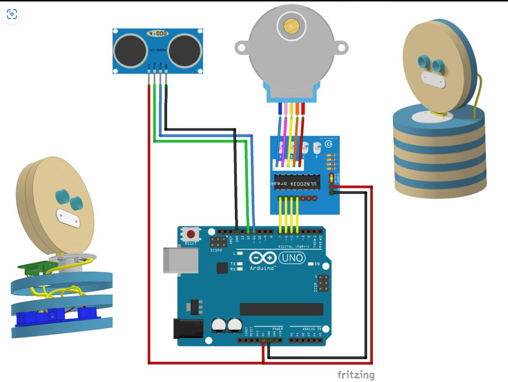

# 🔌 Pin Connections — Arduino Uno

## Signal Mapping

| Arduino Uno | Component | Component pin | Description |
|---|---|---|---|
| D12 | ULN2003 | IN1 / N1 | Stepper phase input 1 |
| D11 | ULN2003 | IN2 / N2 | Stepper phase input 2 |
| D10 | ULN2003 | IN3 / N3 | Stepper phase input 3 |
| D9 | ULN2003 | IN4 / N4 | Stepper phase input 4 |
| D8 | HC-SR04 | TRIG | Starts ultrasonic measurement |
| D7 | HC-SR04 | ECHO | Receives echo pulse |
| D13 | Buzzer | Positive / signal | Audible alert output |
| 5V | HC-SR04 | VCC | Sensor power |
| GND | HC-SR04 | GND | Sensor ground |
| GND | Buzzer | Negative | Buzzer return |

The 28BYJ-48 motor itself plugs into the matching socket on the ULN2003 board; the Arduino connects to the board's IN1–IN4 inputs.

## Motor Power

The common 28BYJ-48 module is sold in different voltage versions. Check the label on the motor and driver assembly and use a supply with the correct voltage and adequate current. If an external supply is used, connect its negative terminal to Arduino GND. The motor supply positive connects to the ULN2003 motor supply input, not to an Arduino digital pin.

## Wiring Diagram

## Pre-Power Checklist

- [ ] ULN2003 IN1, IN2, IN3, IN4 correspond to D12, D11, D10, D9.
- [ ] HC-SR04 TRIG is D8 and ECHO is D7.
- [ ] Buzzer positive is D13 and negative is GND.
- [ ] Sensor VCC is 5 V and sensor GND is common.
- [ ] Motor supply matches the motor's rated voltage.
- [ ] External motor supply GND is connected to Arduino GND.
- [ ] The rotating sensor mount moves freely without pulling wires.

