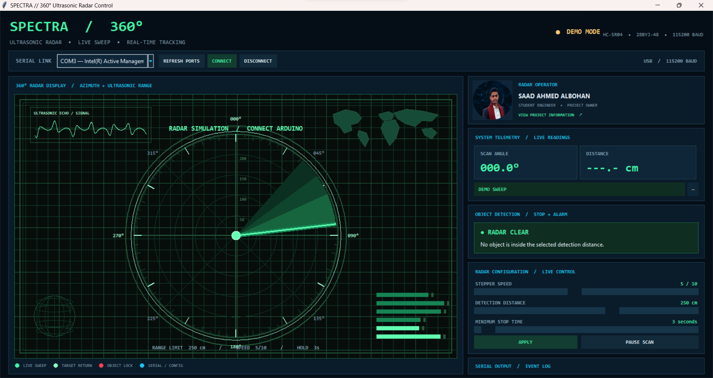

# 🖥️ Python Radar Application

<p align="center"></p>

The Python desktop application provides the operator interface for SPECTRA RADAR 360°. It receives live measurements and state updates from Arduino over USB Serial and sends configuration commands back to the controller.

## 📄 Main Application

- [`radar_gui.py`](radar_gui.py) — Tkinter desktop GUI.

## ✨ Interface Features

- 360° circular radar visualization with a moving sweep sector.
- Scan angle and ultrasonic distance readouts.
- Green normal state and red object-detection alert state.
- COM-port discovery, refresh, connect, and disconnect controls.
- Live controls for motor speed, detection threshold, and minimum stop time.
- Manual pause/resume command.
- Serial receive display and timestamped event log.
- Clickable author profile card and project information window.
- Demo animation before a physical serial connection is active.

<p align="center">
  
</p>

<p align="center"><em>Normal scanning interface preview.</em></p>

<p align="center">
  
</p>

<p align="center"><em>Object-detection alert preview. Screenshot is illustrative, not a measured field test.</em></p>

## 📦 Dependencies

Install from the repository root:

```bash
python -m pip install -r requirements.txt
```

Packages:

- `pyserial` — enumerate COM ports and read/write Serial data.
- `Pillow` — load and resize the author/profile images.
- `tkinter` — GUI toolkit included with most standard Windows Python installations; it is not installed using pip.

## ▶️ Run

Run from the repository root:

```bash
python software/python/radar_gui.py
```

The script resolves image assets from the top-level `assets/images/` folder. Keep the repository structure intact when moving the program.

## 🔌 Connect to Arduino

1. Upload the firmware from `firmware/arduino/`.
2. Close Arduino IDE Serial Monitor.
3. Launch the Python GUI.
4. Refresh the available ports and select the Arduino port (for example, `COM6`).
5. Click **CONNECT**.
6. Use **APPLY** to send settings, or allow the GUI's debounced live-control update to send them after adjustment.

The Python and Arduino programs must use the same baud rate: `115200`.

## 🎛️ Control Ranges

| Control | Range | Effect |
|---|---:|---|
| Stepper speed | 1–10 | Changes step interval and step budget |
| Detection distance | 2–400 cm | Sets the in-range alarm threshold |
| Minimum stop time | 2–30 s | Sets the minimum motor hold time |
| Pause / Resume | — | Sends a manual scan control command |

## 🧵 Threading Model

Serial reading runs in a background thread so the Tkinter event loop remains responsive. The reader thread places incoming lines into a thread-safe queue; the GUI processes the queue on the Tkinter main thread. Serial writes are protected by a lock.

## 🧰 Troubleshooting

- **No ports listed:** check the USB cable, board driver, and Device Manager.
- **Port is busy:** close Arduino IDE Serial Monitor or another application using the COM port.
- **No telemetry:** confirm 115200 baud, upload the matching firmware, then reconnect.
- **Images missing:** preserve the top-level `assets/images/` directory and the repository layout.
- **`serial` import error:** run `python -m pip install pyserial`.
- **Pillow import error:** run `python -m pip install Pillow`.

